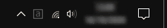

<p align="center">
  <a href="#readme"></a>
</p>

<h1 align="center">caps-indicator</h1>

<p align="center">
  <strong>Lightweight, offline Caps Lock indicator for the Windows notification area, written in Rust.</strong>
</p>

<p align="center">
  <a href="#license"></a>
  <a href="#requirements"></a>
  <a href="https://www.rust-lang.org/"></a>
  <a href="SECURITY.md"></a>
  <a href="#languages"></a>
</p>

---

## Overview

**caps-indicator** shows whether **Caps Lock** is on or off with an icon in the Windows notification area (system tray). It is tiny and self-contained: no settings, no background services and no network access.

<p align="center">
  <a href="#readme"></a>
</p>

| Caps Lock | Tray icon |
| :--- | :--- |
| **Off** | Lowercase `a` (dark gray) |
| **On** | Uppercase `A` (white) |

## Features

- **Instant feedback**: the icon and its tooltip ("Caps Lock: ON" / "Caps Lock: OFF") follow the Caps Lock state, polled every 200 ms with `GetKeyState(VK_CAPITAL)`.
- **Works everywhere**: the toggle state is read globally, so it also updates while elevated apps, games or Remote Desktop have the focus.
- **Keystrokes are never captured**: no keyboard hook is installed; only the Caps Lock toggle state is queried.
- **Survives Explorer restarts**: the tray icon is added back automatically (`TaskbarCreated`).
- **Sharp at any scaling**: per-monitor DPI aware, with multi-resolution icons (16–256 px).
- **Tiny**: a ~130 KB executable with no dependencies (no VC++ runtime).
- **Per-user install**: no administrator rights, starts with Windows, clean uninstall from *Settings → Apps*.
- **Single instance**: starting it a second time only tells you that it is already running.
- **Languages**: English and Spanish, following the Windows display language.

## Requirements

- Windows 10 or Windows 11 (x64, x86 or ARM64).

## Installation

Download the installer from the [Releases](https://github.com/stickylfs/caps-indicator/releases) page and run it:

| File | System |
| :--- | :--- |
| `caps-indicator-setup.exe` | Windows 10/11 64-bit (recommended) |
| `caps-indicator-setup-x86.exe` | Windows 10 32-bit |
| `caps-indicator-setup-arm64.exe` | Windows 11 on ARM |

Each release includes a `SHA256SUMS.txt` file to verify the download.

Everything is installed for the current user, without administrator rights:

| What | Where |
| :--- | :--- |
| Program | `%LOCALAPPDATA%\Programs\caps-indicator` |
| Start Menu | *caps-indicator* folder with a shortcut to the app |
| Start with Windows | On by default; toggle it from the tray icon menu (*Start with Windows*) |

Running the installer again offers **Update** or **Repair** (depending on the installed version) and **Uninstall**.

> [!NOTE]
> `caps-indicator.exe` stores nothing and also runs on its own: copy it from the install folder to use it as a portable app.

### Unattended installation

```powershell
.\caps-indicator-setup.exe --silent              # install, update or repair
.\caps-indicator-setup.exe --uninstall --silent  # uninstall
```

### Uninstall

Use *Settings → Apps → Installed apps → caps-indicator → Uninstall*, or run the installer again and choose **Uninstall**. The program, its shortcut and its startup entry are removed.

## Usage

The icon appears in the notification area as soon as the program starts. Right-click it and choose **Exit** to close it.

> [!TIP]
> If the icon is hidden in the overflow area, drag it onto the taskbar, or enable it in *Settings → Personalization → Taskbar → Other system tray icons*.

## Building from source

Requirements: [Rust](https://rustup.rs/) 1.82+ and the [Visual Studio Build Tools](https://visualstudio.microsoft.com/visual-cpp-build-tools/) with the *Desktop development with C++* workload.

```bash
git clone https://github.com/stickylfs/caps-indicator.git
cd caps-indicator
cargo test --workspace
# The installer embeds the application, so build it first:
cargo build --release -p caps-indicator
cargo build --release -p caps-indicator-installer
```

The installer is written to `target/release/caps-indicator-setup.exe` (the application alone is `target/release/caps-indicator.exe`). For other architectures add `--target i686-pc-windows-msvc` or `--target aarch64-pc-windows-msvc` to both commands.

## Project structure

```
caps-indicator/
├── assets/                          # Tray icons (caps-on.ico, caps-off.ico), app icon and logo
├── crates/
│   ├── caps-indicator/              # Win32 message loop, tray icon and Caps Lock polling
│   └── caps-indicator-installer/    # caps-indicator-setup.exe (per-user installer/uninstaller)
├── .github/workflows/               # CI (lint, test, build) and release pipelines
├── CHANGELOG.md
├── CONTRIBUTING.md
├── SECURITY.md
├── THIRD-PARTY-NOTICES
└── LICENSE
```

## Privacy

caps-indicator has no network code and stores no data; the installer only adds the files, shortcut and startup entry listed above. See [SECURITY.md](SECURITY.md) for details and for how to report vulnerabilities.

## Contributing

Bug reports and pull requests are welcome. See [CONTRIBUTING.md](CONTRIBUTING.md).

## Credits

- Developed with [Google Antigravity](https://antigravity.google) and [Claude](https://claude.ai).
- [windows-sys](https://github.com/microsoft/windows-rs): Microsoft's Rust bindings for the Win32 API.

## License

Released under the [MIT License](LICENSE).
